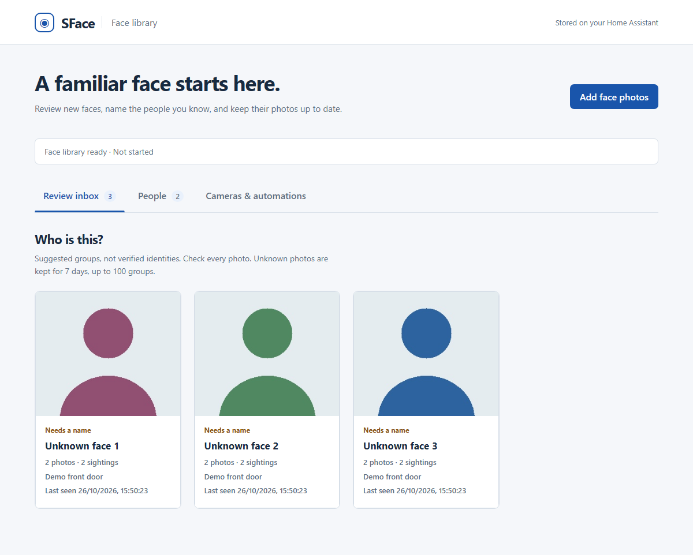
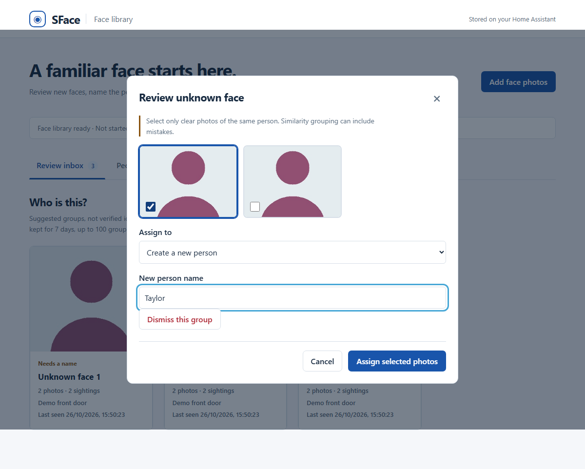
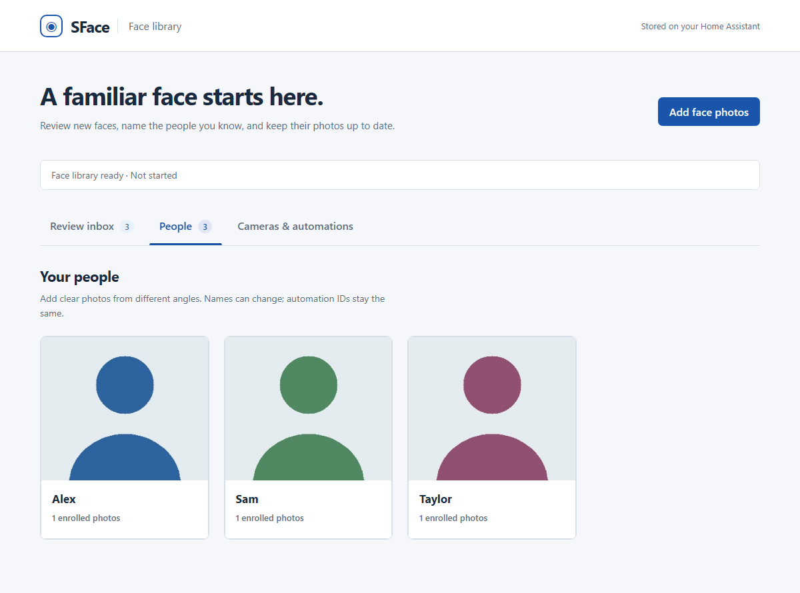
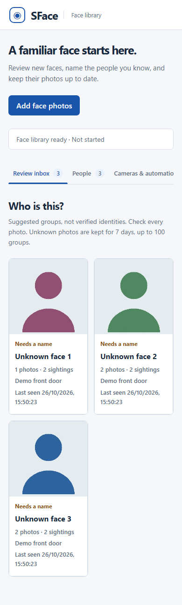
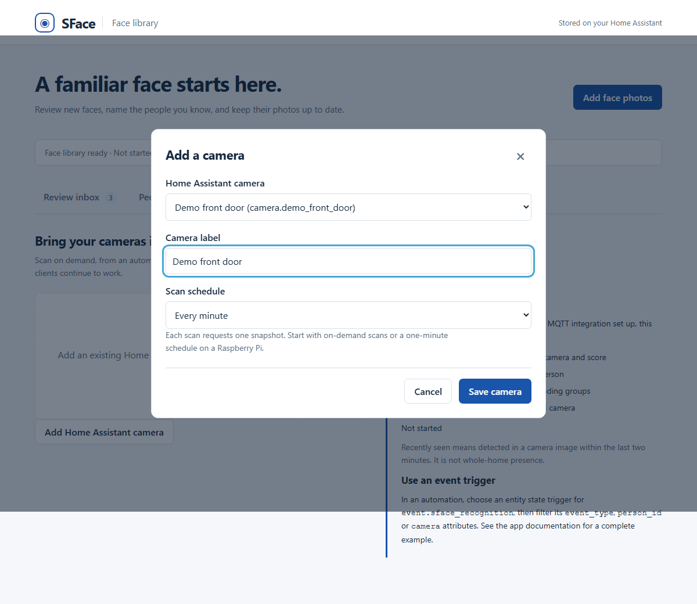

# SFace + YuNet for Home Assistant

[](https://github.com/piyushparkash/home-assistant-sface-yunet/actions/workflows/validate.yml)


[](LICENSE)

**Recognize familiar faces locally. Review unknown faces, give them a name, and use sightings in your automations.**



[Install](#install) · [Name faces](#name-faces) · [Connect a camera](#connect-a-camera) · [Automate](#automate) · [Full docs](sface_yunet/DOCS.md)

- **Local processing:** CPU recognition on your Home Assistant host; no cloud account or API key.
- **Face library:** upload photos, review suggested groups, rename people, and remove samples.
- **Home Assistant entities:** recognition events, recently-seen sensors, review counts, and camera scan buttons through MQTT.
- **Pi friendly options:** on-demand snapshots, adjustable threads, a low-memory guard, and optional live overlays.

Independent community app for **Home Assistant OS with Supervisor**, supporting ARM64 and AMD64. Install through the **app store**; HACS is not required.

## Install

[](https://my.home-assistant.io/redirect/supervisor_store/?repository_url=https%3A%2F%2Fgithub.com%2Fpiyushparkash%2Fhome-assistant-sface-yunet)

1. Click the button above and add the repository. Alternatively, open **Settings → Apps → Install app → ⋮ → Repositories** and paste `https://github.com/piyushparkash/home-assistant-sface-yunet`.
2. Install **SFace + YuNet Face Recognition** and start it. The first build downloads dependencies and about 37 MB of verified OpenCV models.
3. Select **Open Web UI** to open your face library. On older Home Assistant versions, Apps is called **Add-ons**.

To get automation entities, also install **Mosquitto broker** and configure Home Assistant's **MQTT integration**. The face library works without MQTT.

## Name faces

**Already have photos?** Click **Add face photos**, enter a name, and upload clear photos containing one face each.

**Saw someone new on camera?** Open a group in **Review inbox**, select the photos showing the same person, then choose an existing person or enter a new name. Click **Assign selected photos**. Unselected photos stay in the inbox.



Find everyone in **People**. Open a person to rename them, add photos, or remove samples. Their automation ID stays the same when their display name changes.

<details>
<summary>See the People screen and mobile layout</summary>





</details>

Suggested groups need your review; the app never enrolls an unknown person automatically. [Storage, retention and privacy details](sface_yunet/DOCS.md).

## Connect a camera

Open **Cameras & automations → Add Home Assistant camera**. Choose an existing camera entity and a label, then save. Use **Scan now**, an automation, or an optional schedule. Start with on-demand scans or once a minute on a Pi.



Scans populate the review inbox and recognition entities. Existing HTTP clients and training folders are also supported: [API and configuration](sface_yunet/DOCS.md).

## Automate

With MQTT connected, open **Settings → Devices & services → MQTT → SFace face recognition**.

| Want to… | Use this entity |
| --- | --- |
| React to a recognized or unknown face | `event.sface_recognition` |
| Know whether Alex was seen recently | `binary_sensor.sface_person_alex` |
| Show the last recognized name | `sensor.sface_last_recognized` |
| Show how many groups need review | `sensor.sface_pending_groups` |
| Scan a configured camera | Its discovered scan button |

**Example: show “Welcome home, Alex!” when Alex is seen.** Paste into an automation's YAML editor and replace the entity with your person's discovered sensor:

```yaml
alias: Welcome Alex when recognized
triggers:
  - trigger: state
    entity_id: binary_sensor.sface_person_alex
    from: "off"
    to: "on"
actions:
  - action: persistent_notification.create
    data:
      title: Familiar face
      message: "Welcome home, Alex!"
mode: single
```

The sensor stays on for two minutes after a sighting, so continuous sightings do not repeat this notification. It indicates recent camera visibility, not whole-home presence. Entity IDs can vary; check your MQTT device. [Event filters and motion-triggered scans](sface_yunet/DOCS.md#home-assistant-automation-entities).

## Raspberry Pi 4 · 8 GB

Measured on ARM64, app **1.0.2**, two OpenCV threads and low-resolution RTSP overlays:

| Workload | App RAM | Average CPU |
| --- | --- | --- |
| Warmed, no live viewers | ~241 MiB | 0.03% |
| One live overlay | ~245 MiB | ~77% |
| Two live overlays | ~249–276 MiB | ~127% |

Docker CPU scale: **100% = one core; 400% = the Pi's four cores**. These are brief measurements, not sustained-load guarantees or a benchmark of the current face-library release. Snapshot scans consume CPU while processing. [Measurement conditions, CPU ranges, disk use and memory guard](docs/performance.md).

## Documentation and support

[Configuration & API](sface_yunet/DOCS.md) · [Release notes](sface_yunet/CHANGELOG.md) · [Privacy & security](SECURITY.md) · [Report an issue](https://github.com/piyushparkash/home-assistant-sface-yunet/issues)

Photos and embeddings stay in local app storage. The UI uses authenticated Home Assistant Ingress; the unauthenticated recognition API defaults to loopback only. Recognition scores are an automation aid, not an identity guarantee. No household data or automations are bundled.

## Credits

**YuNet:** Wei Wu, Hanyang Peng and Shiqi Yu (MIT). **SFace:** Yaoyao Zhong; ONNX conversion by Chengrui Wang (Apache-2.0). Models are distributed through **OpenCV Zoo**. See [model sources, papers, hashes and bundled licenses](sface_yunet/CREDITS.md). App code is [MIT licensed](LICENSE).

Documentation layout takes inspiration from [Button Card](https://github.com/custom-cards/button-card), [ApexCharts Card](https://github.com/RomRider/apexcharts-card), and [WebRTC Camera](https://github.com/AlexxIT/WebRTC). All screenshots are of this app; [reproduce them with synthetic demo data](docs/capture_screenshots.py).
